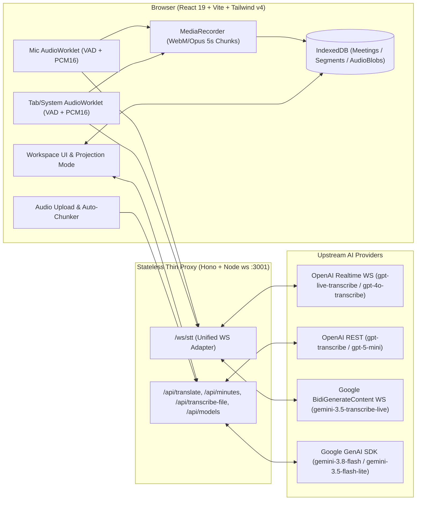

# PolyMeet 專案實作計畫書

## 1. 專案概述與目標

**PolyMeet** 是一個針對會議場景打造的現代化 Web 應用程式，支援 **OpenAI** 與 **Google Gemini** 雙 Provider（支援前端 BYOK 與伺服器 `.env` fallback），滿足以下核心需求：

1. **一般會議模式**：即時收音轉逐字稿（或事後上傳既有錄音檔），會後自由選擇「**僅潤飾**成特定語言會議記錄」或「**翻譯並潤飾**成特定語言會議記錄」。
2. **雙語會議模式**：即時收音並在畫面同步呈現逐字稿與另一方語言的即時譯文，支援**全螢幕投螢幕大字幕模式**與面對面翻轉視圖；會議結束後可一鍵輸出指定語言（或雙語對照）的正式會議記錄。
3. **全包收音與防遺失**：支援「僅麥克風」、「麥克風 + 瀏覽器分頁/系統音訊雙軌分離（區分我方/對方）」、「既有音檔上傳補轉」，並將錄音檔與逐字稿即時分段存入瀏覽器 **IndexedDB**，斷線或重整頁面皆可完整救回。
4. **雙 Provider 混搭**：可自由指定 STT、即時翻譯、會議記錄各自使用 OpenAI 或 Google 模型，具備動態拉取可用模型與自訂 Model ID 功能。

---

## 2. 系統架構圖與資料流



---

## 3. 關鍵技術選型與避坑策略

### 3.1 為什麼採用「無狀態薄後端 WebSocket Proxy」？
1. **瀏覽器 WebSocket 鑑權限制**：瀏覽器原生 `WebSocket` API 不支援自訂 Header（無法附帶 `Authorization: Bearer`），若僅走 ephemeral token 仍存在長會議到期重簽的複雜度；薄 Proxy 允許前端在連線建立後首幀 JSON 傳入 BYOK 金鑰（不放 URL query string、不寫磁碟/日誌），缺省則回退使用伺服器 `.env`。
2. **統一事件協議**：前端只需消費一套標準化的 `SttServerEvent`（`interim` / `final` / `status` / `error`），徹底隔離 OpenAI 與 Google 不同的底層訊息結構。
3. **穩定掛載**：使用 `@hono/node-server` 搭配 Node 原生 `http.Server` 的 `upgrade` 事件與 `ws` 套件（`WebSocketServer({ noServer: true })`），避開已被棄用的 `@hono/node-ws`。

### 3.2 雙 Provider 2026 即時 STT 地雷排除
- **Google `gemini-3.5-transcribe-live` 不送 `serverContent.turnComplete`**：該模型只會推送 `serverContent.interimInputTranscription`（暫定文字）與 `serverContent.inputTranscription`（定稿文字）。Proxy 絕對不等待 `turnComplete`，收到 `inputTranscription` 即視為定稿並轉發前端。
- **OpenAI `gpt-live-transcribe` 不支援 `server_vad`**：若傳入 `turn_detection: { type: "server_vad" }` 會拋出 `invalid_request_error`。因此使用該模型時強制設為 `turn_detection: null`，由前端 `AudioWorklet` 的輕量能量 VAD 在語音停頓（~700ms）或超過單句上限（18s）時送出 `audio.commit`，Proxy 再轉為 `input_audio_buffer.commit`；若使用者選用 `gpt-4o-transcribe`，則自動改開 `server_vad`。
- **長會議連線逾時處理**：Gemini Live 存在單次連線時限（約 10–15 分鐘，會推送 `goAway`），OpenAI 約 30–60 分鐘。前端 `LiveSttClient` 具備自動無縫重連機制，並維護 500ms PCM pre-roll ring buffer，確保換線不漏字。

### 3.3 音訊採集與檔案補轉
- **Chrome 分頁音訊擷取**：呼叫 `getDisplayMedia({ video: true, audio: { suppressLocalAudioPlayback: false } })` 時，設 `videoTrack.enabled = false` 而不直接呼叫 `videoTrack.stop()`（避免部分 Chromium 版本連帶中斷音訊），並監聽 `audioTrack.onended` 同步停止錄音。
- **雙軌音訊管理**：麥克風與系統音訊各走獨立 `AudioWorkletNode` 識別「我方」與「對方」，同時透過 `ChannelMergerNode` 混音給 `MediaRecorder` 每 5 秒輸出 WebM/Opus 切片存入 IndexedDB。
- **突破 OpenAI 25MB 上傳上限**：前端利用 Web Audio API `decodeAudioData` 自動將大音檔切為每段 10 分鐘的 16kHz mono WAV（約 19MB）分段上傳並重組時間軸；Google 則走 `@google/genai` Files API 進行音檔轉錄，處理完成後自動刪除雲端暫存檔。

---

## 4. 模型配置矩陣

| 功能模組 | OpenAI 預設（可自訂） | Google 預設（可自訂） | 備註說明 |
| :--- | :--- | :--- | :--- |
| **即時串流 STT** | `gpt-live-transcribe` | `gemini-3.5-transcribe-live` | 備選：`gpt-4o-transcribe`、`gpt-4o-mini-transcribe` |
| **離線音檔 STT** | `gpt-transcribe` | `gemini-3.8-flash` | 備選：`whisper-1`，Google 輸出 JSON Schema 結構化時間軸 |
| **即時雙語翻譯** | `gpt-5-mini` | `gemini-3.5-flash-lite` | 滑動上下文雙向判斷，超低延遲串流輸出 |
| **會議記錄生成** | `gpt-5-mini` | `gemini-3.8-flash` | 支援「僅潤飾」與「翻譯並潤飾」，備選 `gpt-5` |

---

## 5. 專案目錄結構

```text
PolyMeet/
├── package.json
├── tsconfig.json
├── tsconfig.server.json
├── vite.config.ts
├── vitest.config.ts
├── .prettierrc
├── .env.example
├── .gitignore
├── index.html
├── public/
│   └── audio-worklet.js              # 獨立 AudioWorkletProcessor (線性重採樣 + PCM16 + RMS VAD)
└── src/
    ├── shared/
    │   ├── types.ts                  # Meeting, TranscriptSegment, MinutesRecord, Settings 型別
    │   ├── protocol.ts               # WS 客戶端/伺服器訊息與 REST DTO 契約
    │   ├── languages.ts              # 支援語言清單 (zh-TW, zh-CN, en, ja, ko, vi, th, fr, de, es 等)
    │   └── models.ts                 # 雙 Provider 預設模型常數與能力標記
    ├── server/
    │   ├── index.ts                  # Hono HTTP Server + Node http.Server upgrade 掛載 WS
    │   ├── config.ts                 # 環境變數讀取與 key 解析 (Header 優先於 .env)
    │   ├── routes/
    │   │   ├── health.ts             # GET /api/health (回傳 serverKeys 可用狀態，不洩漏金鑰)
    │   │   ├── models.ts             # GET /api/models (查詢雙方帳號可用模型)
    │   │   ├── translate.ts          # POST /api/translate/stream (SSE 雙語上下文串流翻譯)
    │   │   ├── minutes.ts            # POST /api/minutes/stream (SSE 潤飾 / 翻譯並潤飾會議記錄)
    │   │   └── transcribe.ts         # POST /api/transcribe-file (離線音檔分段轉錄)
    │   ├── providers/
    │   │   ├── openai.ts             # OpenAI Chat/Responses 串流、音檔轉錄封裝
    │   │   └── gemini.ts             # @google/genai 串流、Files API 音檔轉錄封裝
    │   └── ws/
    │       ├── sttProxy.ts           # /ws/stt 入口與生命週期管理
    │       ├── openaiRealtime.ts     # OpenAI Realtime WS 轉接器
    │       └── geminiLive.ts         # Google BidiGenerateContent WS 轉接器
    └── client/
        ├── main.tsx
        ├── App.tsx
        ├── styles/
        │   └── index.css             # Tailwind v4 + light-dark() 主題 tokens + dialog overscroll 規則
        ├── db/
        │   └── meetingDb.ts          # IndexedDB (idb) 封裝：meetings / segments / audioChunks / minutes
        ├── audio/
        │   ├── captureManager.ts     # Mic + getDisplayMedia 雙軌管理、AudioWorklet、MediaRecorder
        │   ├── liveSttClient.ts      # 單軌/雙軌 WS 客戶端、斷線自動重連與 500ms pre-roll
        │   └── audioChunker.ts       # Web Audio 解碼與 16kHz WAV 分段器
        ├── services/
        │   ├── apiClient.ts          # 帶 BYOK Header 的 REST / SSE 串流客戶端
        │   ├── translationQueue.ts   # 雙語會議即時翻譯排程器 (滑動上下文 + 併發控制)
        │   └── exporter.ts           # 匯出 Markdown / TXT / JSON / WebM 原始錄音
        ├── store/
        │   ├── settingsStore.ts      # API Key (localStorage/sessionStorage)、Provider 與模型設定
        │   └── meetingStore.ts       # 當前會議狀態、即時段落、錄音控制、歷史清單
        └── components/
            ├── Sidebar.tsx           # 歷史會議列表、關鍵字搜尋、新建會議、上傳音檔
            ├── ControlBar.tsx        # 模式切換、語言選擇、音訊來源、開始/暫停/停止錄音、VU 電平表
            ├── TranscriptFeed.tsx    # 即時逐字稿/雙語對照流、聲道標籤、inline 編輯、音檔跳轉播放
            ├── MinutesStudio.tsx     # 潤飾 vs 翻譯並潤飾控制面板、SSE 串流預覽、Markdown 編修與匯出
            ├── ProjectionOverlay.tsx # 雙語大字幕投螢幕模式 (上下字幕/左右分欄/180°翻轉/字級控制)
            ├── SettingsDialog.tsx    # 原生 <dialog> BYOK 與模型設定面板
            └── UploadAudioDialog.tsx # 原生 <dialog> 音檔上傳與轉錄進度視窗
```

---

## 6. 核心介面與協議定義

### 6.1 統一 WebSocket 串流通訊協議 (`src/shared/protocol.ts`)

```typescript
export type ProviderId = 'openai' | 'gemini';
export type AudioTrackRole = 'mic' | 'system' | 'mixed' | 'upload';

// 瀏覽器 -> 薄 Proxy (/ws/stt)
export type SttClientMessage =
  | {
      type: 'session.start';
      provider: ProviderId;
      apiKey?: string;
      model: string;
      sampleRate: 16000 | 24000;
      languageHints?: string[];
      track: AudioTrackRole;
    }
  | { type: 'audio.chunk'; pcm16Base64: string }
  | { type: 'audio.commit' }
  | { type: 'session.stop' };

// 薄 Proxy -> 瀏覽器 (/ws/stt)
export type SttServerEvent =
  | { type: 'session.ready'; provider: ProviderId; model: string }
  | { type: 'transcript.interim'; segmentId: string; text: string; track: AudioTrackRole }
  | { type: 'transcript.final'; segmentId: string; text: string; track: AudioTrackRole }
  | { type: 'session.reconnecting'; reason: string }
  | { type: 'error'; code: string; message: string; recoverable: boolean };
```

### 6.2 資料儲存結構 (`src/shared/types.ts` & IndexedDB)

```typescript
export type MeetingMode = 'standard' | 'bilingual';
export type MinutesAction = 'polish' | 'translate_and_polish';

export interface Meeting {
  id: string;
  title: string;
  createdAt: number;
  updatedAt: number;
  mode: MeetingMode;
  sourceLang?: string;
  targetLang?: string;
  durationSeconds: number;
  hasAudioBackup: boolean;
}

export interface TranscriptSegment {
  id: string;
  meetingId: string;
  track: AudioTrackRole;
  speakerLabel: string;
  startedAtMs: number;
  endedAtMs?: number;
  text: string;
  detectedLang?: string;
  translation?: string;
  isFinal: boolean;
}

export interface MinutesRecord {
  id: string;
  meetingId: string;
  createdAt: number;
  action: MinutesAction;
  targetLanguage: string;
  style: 'standard' | 'action_items' | 'detailed';
  markdownContent: string;
}
```

---

## 7. 畫面與使用者體驗設計

1. **現代化主題與色彩系統**：
   - 遵照現代 Web 標準，在 `index.html` 宣告 `<meta name="color-scheme" content="light dark">`，防止載入閃白。
   - 在 CSS `:root` 宣告 `color-scheme: light dark;`，運用 `light-dark()` 定義語意色票，並配置 `@media (prefers-color-scheme: dark)` 與 `@supports (color: light-dark(white, black))` fallback。
2. **原生 `<dialog>` 彈窗規格**：
   - 設定頁面與音檔上傳視窗採用原生 `<dialog>` + `showModal()` 開啟，支援 `closedby="any"` 與 Safari 指標範圍 light-dismiss fallback。
   - 加入樣式防止背景滾動穿透：
     ```css
     dialog:modal {
       overscroll-behavior: contain;
     }
     dialog::backdrop {
       overflow: hidden;
       overscroll-behavior: contain;
     }
     ```
   - 關閉時重置 `dialog.returnValue = ''`，杜絕舊狀態洩漏。
3. **雙語投螢幕大字幕模式 (`ProjectionOverlay.tsx`)**：
   - 元件層級強制套用 `color-scheme: dark`，使用純黑高對比樣式，確保投影機與大螢幕清晰易讀。
   - 支援三種呈現視圖：
     - **上下字幕視圖**：原文較小半透明置頂、即時譯文超大粗體置中，自動平滑滾動。
     - **左右分欄視圖**：雙語左右對照顯示。
     - **面對面 180° 翻轉視圖**：將上方區域旋轉 180°，適合平板平放於會議桌對談。
   - 鍵盤快速鍵：`F` 全螢幕開關、`+` / `-` 調整字級大小、`Esc` 退出投螢幕；滑鼠閒置 3 秒自動隱藏工具列。
4. **會議記錄編輯室 (`MinutesStudio.tsx`)**：
   - 提供「僅潤飾」與「翻譯並潤飾」一鍵切換，自選目標輸出語言與紀要風格（標準紀要 / 行動清單優先 / 詳細脈絡）。
   - 支援 SSE 即時串流生成、即時 Markdown 預覽與手動編修，支援同一場會議生成並保留多個版本。
   - 支援一鍵匯出 `.md`、`.txt`、`.json` 及 `.webm` 原始錄音。

---

## 8. 驗證與測試計畫

### 8.1 自動化驗證
- **型別檢查**：執行 `npm run typecheck` 確保前後端及共用型別無任何錯誤。
- **單元測試 (`vitest`)**：
  - `tests/audio.test.ts`：驗證 Float32 轉 PCM16、重採樣精確度、WAV 檔頭產生器及前端能量 VAD 切句狀態機。
  - `tests/wsAdapters.test.ts`：模擬 OpenAI 與 Google WebSocket 封包，驗證 `gpt-live-transcribe` 的 `turn_detection: null` 與 `audio.commit` 行為，以及 `gemini-3.5-transcribe-live` 在沒有 `turnComplete` 時的解析正確性。
  - `tests/serverRoutes.test.ts`：驗證 REST 端點之 BYOK Header 覆寫機制、缺金鑰錯誤代碼與日誌敏感資訊過濾。
  - `tests/meetingDb.test.ts`：使用 `fake-indexeddb` 測試會議 CRUD、音訊分塊儲存與合併匯出。
- **建置檢查**：執行 `npm run build` 確認前端 Vite 與後端 TypeScript 編譯成功。

### 8.2 手動驗證清單
1. **啟動測試**：執行 `npm run dev`，確認 Vite 與 Hono Proxy 順暢啟動，UI 正常渲染且無主控台錯誤。
2. **一般會議測試**：開啟麥克風收音 30 秒，確認即時逐字稿穩定輸出，測試「僅潤飾」及「翻譯並潤飾」產出會議記錄，並確認 `.md` 匯出格式正確。
3. **雙語會議測試**：切換為雙語模式（例如：中英），說話時確認即時雙向翻譯與上下大字幕顯示，測試 180° 翻轉與全螢幕功能。
4. **線上雙軌與上傳補轉**：啟動「麥克風 + 分頁音訊」，播放外部聲音驗證我方與對方雙軌標籤；拖曳既有音檔至上傳視窗，驗證大檔切片與離線逐字稿生成功能。
5. **重整持久化測試**：在錄音進行中或結束後強制重新整理頁面，驗證歷史會議、逐字稿與錄音檔完好如初。
